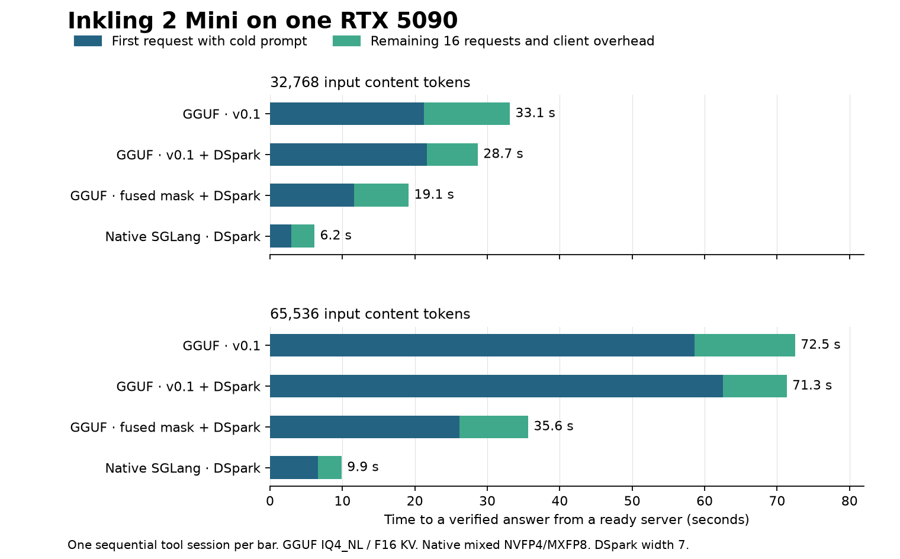

# Inkling Mini Blackwell

Run Thinking Machines’ Inkling 2 Mini locally on an RTX 5090 with llama.cpp, the original IQ4_NL GGUF, two downstream CUDA optimizations and DSpark speculative decoding. The server exposes an OpenAI-compatible chat endpoint for local tools and coding agents.

On one RTX 5090, the optimized build completed a 64K-context, 16-tool-call task in **34.3–35.6 seconds**, down from **72.5 seconds** with the previous GGUF release. The task ran on a ready server. Native SGLang with its standard graphs completed the same task in **9.9–10.0 seconds** on its mixed-precision checkpoint.



## Build and serve

Tested on **Linux x86-64 with a 32 GB RTX 5090** (SM120, GPU 0). You need a working NVIDIA driver, Docker with NVIDIA GPU access, Git and uv. Allow space for about 19 GB of model assets, plus CUDA images and build trees. Run these commands from the extracted directory.

```bash
mkdir -p .work
uv venv --python 3.12 .work/venv
uv pip install --python .work/venv/bin/python -r repro/requirements.txt
.work/venv/bin/python scripts/fetch.py gguf
.work/venv/bin/python scripts/fetch.py dspark-draft
scripts/build
scripts/build-dspark --fused-mask --output .work/dspark-fused-repro
export INKLING_DSPARK_BUILD="$PWD/.work/dspark-fused-repro/build"
export INKLING_EXPLICIT_REL_MASK=1 INKLING_CTX=69632 INKLING_VISION=0
INKLING_PORT=18718 scripts/serve-gguf-dspark
```

The build fetches the pinned llama.cpp source and compiles it in Docker. The downloader verifies the public model files and reuses the Hugging Face cache. The launcher defaults to seven draft proposals and a single slot. Keep it running and point your client at `http://127.0.0.1:18718/v1` with model ID `inkling-mini`. To send a first request, open a second terminal.

```bash
curl --fail http://127.0.0.1:18718/v1/chat/completions \
  -H 'Content-Type: application/json' \
  -d '{"model":"inkling-mini","messages":[{"role":"user","content":"What is 7 times 8?"}],"temperature":0,"max_tokens":256}'
```

## Reproduce the measurements

Stop the server with Ctrl-C before running the benchmarks. Use a fresh output directory for each invocation. The first benchmark alternates the fused mask off and on inside the same binary. The second starts a new server, sends a 65,536-token content prefix, executes 16 dependent tool calls and verifies the final answer. Both record machine-readable results.

```bash
scripts/reproduce-mask-prefill results-prefill
.work/venv/bin/python scripts/fetch.py tokenizer
export INKLING_DSPARK_BUILD="$PWD/.work/dspark-fused-repro/build"
INKLING_EXPLICIT_REL_MASK=1 AGENT_CHAIN_LENGTH=16 INKLING_PORT=18719 \
  scripts/run-agent-session gguf-dspark results-agent-64k 64k
AGENT_CHAIN_LENGTH=16 INKLING_PORT=18720 \
  scripts/run-agent-session patch results-previous-64k 64k
```

| Ready-server task | Previous GGUF | Patched GGUF + DSpark + fused mask | Native SGLang, standard graphs |
| --- | ---: | ---: | ---: |
| 32K prefix | 33.1 s | 18.5–19.1 s | 5.8–6.2 s |
| 64K prefix | 72.5 s | 34.3–35.6 s | 9.9–10.0 s |

All times are single-user measurements on the same card. Ranges show two same-host runs. The fixture checks each tool name and argument and the final result. Native SGLang ran the mixed NVFP4/MXFP8 checkpoint with native DSpark. The GGUF run used IQ4_NL weights and F16 KV. All 25 tool sessions across the configurations passed. [Per-run measurements](evidence/gguf-dspark/summary.json) · [Agent fixture](scripts/agent_session.py)

The fused mask raised median 32K prompt processing from 1,743 to 3,964 tokens/s across three alternating runs per setting. DSpark roughly doubled generation throughput at 64K. With the mask enabled, every logit matched on 32 subsequent decode steps after both 32K and 64K histories. A separate coding task passed seven executable checks. [Fixed-work samples and profiler tables](evidence/gguf-dspark/) · [Deep-logit comparison](evidence/gguf-dspark/deep-independent.json) · [Coding results](evidence/gguf-dspark/code-quality.json)

## Source and credit

Varesh Patel’s downstream changes are the short-reduction CUDA kernel and fused relative-position mask. The latter combines the position lookup, mask addition and final conversion in one operation for supported single-stream prefills. AI agents assisted with implementation, profiling and verification. The benchmarked implementation is `48c32b12c9efa39d529011af24557b9a72821ea3`. [Short-reduction patch](patches/sm120-short-reduction.patch) · [Mask patch](patches/sm120-inkling-rel-mask.patch) · [Source license](LICENSE)

Thinking Machines supplied Inkling 2 Mini and its drafter. ggml-org supplied llama.cpp and the target GGUF conversion. The bundled DSpark integration is pinned to upstream PR 32218, and Unsloth supplied the Q8_0 draft GGUF. Model files are downloaded from their publishers under their respective terms. [Model](https://huggingface.co/thinkingmachines/Inkling-2-Mini) · [Target GGUF](https://huggingface.co/ggml-org/Inkling-2-Mini-GGUF) · [llama.cpp base](https://github.com/ggml-org/llama.cpp/commit/e6d624b9a4b95c6b52f5ca384d70b75581f9821a) · [Upstream DSpark integration](https://github.com/ggml-org/llama.cpp/pull/32218) · [Draft GGUF](https://huggingface.co/unsloth/Inkling-2-Mini-GGUF)
